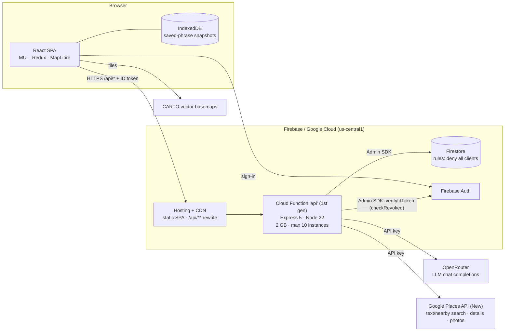

# VoxTrail Architecture

> Evaluated 2026-10-02 on branch `css-variables-theme` (includes `design-system-fixes` and the Codex audit commit).
> Constraints this review designs for: **solo/small team**, **costs near the free tier**, **preparing for real users**, and a **portfolio/learning** project where clear, defensible decisions matter as much as scale.
> Decisions that need sign-off are written up as ADRs in [`docs/adr/`](../adr/README.md).

---

## 1. Summary

VoxTrail is a React SPA on Firebase Hosting with one Express 5 API deployed as a Cloud Function. The API proxies three paid providers (OpenRouter for AI, Google Places for stays/places/photos, Firebase Auth for identity) and stores user data in Firestore, which browsers can't access directly. That shape suits the team and budget: everything is managed, scales to zero, and the browser never holds a provider key.

The weak points aren't in the shape. They're in three operational details that will bite as soon as real users arrive:

1. **The API can serve only 10 requests at once, app-wide.** It runs on Cloud Functions *1st gen* (one request per instance) with `maxInstances: 10`. Every photo on a results page and every slow AI call takes up a whole instance → [ADR-001](../adr/001-api-runtime-2nd-gen.md).
2. **Spend controls are uneven.** AI generation has durable per-user quotas, but translation has none. Two Google-billed endpoints are public. The AI default is a *free* OpenRouter model whose 50-requests-per-day cap is shared by all users, and the paid fallback's model ID looks invalid → [ADR-002](../adr/002-abuse-and-cost-protection.md), [ADR-003](../adr/003-ai-provider-strategy.md), [ADR-004](../adr/004-place-photos-and-places-skus.md).
3. **Some protections can't do their job.** The HMAC request signing has no client that signs. User-agent filtering is trivially bypassed. The four layers of in-memory rate limits are per instance and reset on cold start. They add code and a required secret without stopping abuse → [ADR-002](../adr/002-abuse-and-cost-protection.md).

On the frontend, Redux holds two real slices and four empty ones. Server data is fetched by hand in every page. The Emergency page ships a 2.2 MB data file → [ADR-005](../adr/005-frontend-server-state.md), [ADR-006](../adr/006-emergency-data-offline.md).

**Verdict:** the architecture is sound for this project. Don't re-platform. Accept ADR-001 to ADR-004 before inviting users (each is a day or less of work). Do ADR-005 and ADR-006 when you next work on those areas.

---

## 2. System context

### What runs where

| Layer | Implementation | Key files |
|-------|----------------|-----------|
| SPA | React 18, Vite 8, MUI 7 (CSS-variables theme), React Router 7, Redux Toolkit + redux-persist, MapLibre GL, framer-motion | `travel-app-fe/src/App.jsx`, `theme.js`, `store/` |
| Identity | Firebase Auth (browser SDK); the API verifies ID tokens with revocation checks | `contexts/AuthContext.jsx`, `travel-app-be/src/middleware/authenticate.js` |
| API | Express 5 app wrapped by `firebase-functions/v1` `https.onRequest` | `travel-app-be/index.js`, `src/app.js` |
| Data | Firestore via Admin SDK only: users, saved phrases, culture briefs, usage quotas | `src/config/firebaseAdmin.js`, `firestore.rules` |
| AI | OpenRouter chat completions with a model fallback chain, 30 s per attempt | `src/lib/openrouterClient.js` |
| Places | Google Places API (New): city lookup (Text Search), lodging/POI (Nearby Search), details, photo proxy | `src/stays/providers/googlePlaces.js`, `src/poi/providers/googlePlacesPoi.js` |
| Maps | MapLibre + CARTO Positron vector style (keyless) | `components/stays/StaysMap.jsx`, `components/discover/DestinationMap.jsx` |
| Offline | Saved phrases in IndexedDB, recent activity in localStorage, both scoped by user ID | `services/offlineCache.js`, `utils/recentActivity.js` |
| CI/release | Vitest (FE), Jest + Supertest (BE), Firebase emulator smoke tests, deploy script that blocks on failed tests | `scripts/`, `package.json` |

> **Docs drift:** `CLAUDE.md`, `claude.md` and `Agents.md` (three copies of the same file) still say translation uses `@huggingface/transformers` and the frontend uses React Query. Neither is true. AI agents read those files first, so they'll act on the wrong stack. Replace all three with one short `AGENTS.md` that links here.

---

## 3. Request lifecycle

Every `/api/*` request passes through this chain in `src/app.js`, in order:

| # | Middleware | Scope | Notes |
|---|-----------|-------|-------|
| 1 | `requestContext` | all | Request ID |
| 2 | CORS allow-list | all | Hard-coded production origins plus env override |
| 3 | Helmet (CSP etc.) | all | API responses are JSON; the CSP mainly matters for Hosting HTML, which has its own headers |
| 4 | JSON / urlencoded body (256 kB) | all | |
| 5 | `attachUserContext` | all `/api` | **Verifies the ID token with `checkRevoked: true` on every request**, so each one makes an extra call to Firebase Auth (`authenticate.js:43`) |
| 6 | Role-based limiter (20 / 60 / 120 per min) | `/api` except photos | In-memory, per instance |
| 7 | Endpoint limiters (8 paths) | per path | In-memory, per instance |
| 8 | Method-based limiter | `/api` except photos | In-memory, per instance |
| 9 | `addSecurityHeaders`, `enhancedAuthorization` (header + user-agent heuristics), `securityLogging` | all | UA heuristics only apply to anonymous requests |
| 10 | Response-time recorder | all | In-memory per instance; exposed at `/api/metrics/perf` |
| 11 | `validateRequestSignature` | POST/PUT/PATCH/DELETE on `/api/stays`, `/api/poi`, `/api/itinerary` | Skipped when a Bearer token is present. **The SPA never signs requests**, and every protected route already requires auth (§5, H3) |
| 12 | Route: `requireAuth` → schema validation → durable quota → controller | per route | Durable quotas are Firestore transactions keyed by user, day/window and endpoint |

That's three rate-limit layers, two heuristic layers and one signature layer in front of the checks that actually hold: authentication plus durable quotas.

---

## 4. Evaluation by quality attribute

| Attribute | Rating | Why |
|-----------|:------:|-----|
| **Fit for team & budget** | ✅ Good | All managed, scales to zero, one deployable, one region. Low ops burden |
| **Security (data)** | ✅ Good | Firestore denies all client access; all writes go through the API with server-side validation (zod). Tokens are checked for revocation. Provider keys stay server-side. User-scoped offline storage |
| **Cost control** | ⚠️ Uneven | Durable quotas on AI generation and stays search are good. Gaps: translation has no durable quota; public photo and location endpoints are billed per call; Places field masks pull Enterprise/Atmosphere SKUs; no budget alerts or provider caps in the repo (§6) |
| **Scalability / concurrency** | ❌ Weak | 1st gen = 1 concurrent request per instance; max 10 instances = 10 in-flight requests across all users. Photos and AI calls hold instances for seconds |
| **Reliability** | ⚠️ Fair | The AI default is a free model capped at 50 requests/day for the whole account; the paid fallback ID `gpt-4o-mini` lacks OpenRouter's `openai/` prefix (needs a live check). In-memory caches and limits reset on cold start |
| **Abuse resistance** | ⚠️ Fair | Authenticated paths are fine. Anonymous paths (`/api/stays/photo`, `/api/location/resolve`) are protected only by per-instance IP limits and user-agent strings |
| **Performance** | ⚠️ Fair | Every authed request makes an extra round-trip to Auth for the revocation check. The Emergency chunk is 1.56 MB (269 kB gzip). Map vendor chunk 276 kB gzip (lazy). Firestore client SDK bundled but unused |
| **Maintainability** | ⚠️ Fair | Clear route/controller/provider layering and good tests (156 FE + 120 BE). About 900 lines of unused stays providers (`google.js`, `googleHotels.js`, `osm.js`), an archived `functions/` codebase, duplicate quota checks on stays, and stale agent docs |
| **Observability** | ⚠️ Fair | Request IDs and standardized errors. Logs are unstructured `console.log`; `/api/metrics/perf` reports one instance's memory only. No alerting on spend or error rate |
| **Testability / DX** | ✅ Good | Emulator-based smoke tests, failing tests block deploy, lint now configured, Node version pinned |

---

## 5. Findings, ranked

### High — fix before inviting users

| ID | Finding | Evidence | Fix |
|----|---------|----------|-----|
| H1 | API capped at **10 concurrent requests** app-wide | `index.js:1` (`firebase-functions/v1`), `index.js:13` (`maxInstances` 10); 1st gen concurrency is 1 per instance | [ADR-001](../adr/001-api-runtime-2nd-gen.md): 2nd gen with concurrency 80 |
| H2 | AI requests share one **50/day** free-model allowance; paid fallback likely invalid | `.env.example` `OPENROUTER_MODEL=x-ai/grok-4.1-fast:free`; `openrouterClient.js:4` `FALLBACK_MODEL = "gpt-4o-mini"` | [ADR-003](../adr/003-ai-provider-strategy.md) |
| H3 | Public, billable endpoints protected only by in-memory IP limits and UA strings | `staysRoutes.js:79` (photo proxy, no auth, exempt from role/method limits); `locationRoutes.js:23` (Text Search, no auth); `security.js:442-449` | [ADR-002](../adr/002-abuse-and-cost-protection.md) |
| H4 | Translation (an LLM call) has no durable quota | `translationRoutes.js` has only `requireAuth`; other AI routes use `durableDailyQuota` | ADR-002 / ADR-003 |
| H5 | No spend guardrails outside the code | No budget alerts or per-API daily caps documented in `PRODUCTION_DEPLOYMENT.md` or `ENVIRONMENT_VARIABLES.md` | ADR-002 action items (console settings, 15 minutes) |

### Medium

| ID | Finding | Evidence | Fix |
|----|---------|----------|-----|
| M1 | Places field masks pull Atmosphere SKUs (`reviews`, `editorialSummary`) into the default stay-details and POI-search calls; city lookup uses Text Search Pro ($32) where Geocoding ($5) fits | `googlePlaces.js:459`, `:601`; `googlePlacesPoi.js:159` | [ADR-004](../adr/004-place-photos-and-places-skus.md) |
| M2 | Request signing is required to boot but protects nothing | `app.js:62` throws without `REQUEST_SIGNING_SECRET`; no `x-request-signature` anywhere in the SPA | ADR-002: remove |
| M3 | Revocation check on every request | `authenticate.js:43`, `app.js:204` | ADR-002: only check revocation on sensitive writes |
| M4 | Secrets are plain environment variables | `config/env.js`; no `defineSecret` usage | ADR-001: Secret Manager via 2nd gen `secrets` |
| M5 | Frontend server state is fetched by hand in every page; Redux has 4 empty slices | `store/slices/*` (11-line stubs); per-page request-sequence guards added in the audit | [ADR-005](../adr/005-frontend-server-state.md) |
| M6 | Emergency page ships a 2.2 MB alias dataset (1.56 MB chunk) and isn't available offline | `src/data/emergencyLocationAliases.js`, `Emergency.jsx:27-28` | [ADR-006](../adr/006-emergency-data-offline.md) |
| M7 | Docs drift: three agent-instruction copies describe a stack that doesn't exist | `CLAUDE.md`, `claude.md`, `Agents.md` | Replace with one `AGENTS.md` |

### Low

| ID | Finding | Fix |
|----|---------|-----|
| L1 | `usageQuotas` documents never expire | Add an `expireAt` field plus a Firestore TTL policy |
| L2 | Stays search is quota-checked twice (durable *and* in-memory `enforceQuota`) | Keep the durable check only |
| L3 | Unused code: `stays/providers/{google,googleHotels,osm}.js`, `travel-app-be/functions/` | Delete |
| L4 | Firestore client SDK imported but unused (`src/firebase.js:3`) | Remove `getFirestore` to shrink `vendor-firebase` |
| L5 | `/api/metrics/perf` shows one instance's memory | Use structured JSON logs and Cloud Logging log-based metrics instead |
| L6 | CARTO basemaps are keyless; free commercial use is capped at 1M tile requests/month, and keys are now required for raster tiles | Request a free key now; vector style still works without one |

---

## 6. Cost model (free caps and unit prices)

Prices are Google Maps Platform list prices (first paid tier, per 1,000 calls, checked 2026-10-02). SKU tiers depend on the **field mask**, so the same endpoint can cost 5–8× more depending on which fields you request.

| User action | Provider call(s) today | SKU | Free / month | Then per 1,000 |
|-------------|------------------------|-----|-------------:|---------------:|
| Resolve a city | `places:searchText` | Text Search Pro | 5,000 | $32 |
| *(alternative)* | Geocoding | Geocoding (Essentials) | 10,000 | $5 |
| Stays search | `places:searchNearby` with rating/price/hours | Nearby Search **Enterprise** | 1,000 | $35 |
| Explore (POI) search | `places:searchNearby` with rating + `editorialSummary` | Nearby Search **Enterprise + Atmosphere** | 1,000 | $40 |
| *(alternative)* | either, without rating/price/hours/editorial | Nearby Search Pro | 5,000 | $32 |
| Stay details | details with reviews/editorial | Place Details **Enterprise + Atmosphere** | 1,000 | $25 |
| *(alternative)* | same, without reviews/editorial | Place Details Enterprise | 1,000 | $20 |
| Each photo shown | photo media via `/api/stays/photo` | Place Details Photos | 1,000 | $7 |
| AI generation | OpenRouter `:free` model | — | 50 requests/day account-wide (1,000/day after buying ≥ 10 credits); 20/min | paid models: per-token |

**What this means:** the first free cap you'll hit is **photos**. A results page shows 5 cards with one photo each, so 1,000 free photos is about 200 results pages a month. Past the free caps, a typical stays session (1 city lookup + 1 search + 5 photos + 1 details page with 3 photos) costs roughly **$0.15**, about $150 per 1,000 sessions. ADR-004 brings it to about **$0.10** (roughly a third less). Most of the saving comes from a cheaper city lookup, no Atmosphere fields on the default details call, and one photo per page view instead of three on details. Ratings and prices stay on stay cards, which keeps searches on the Enterprise SKU (1,000 free a month) on purpose.

Firebase side (Blaze plan, required for outbound calls): Firestore's no-cost quota is 50K reads / 20K writes / 20K deletes per day and 1 GiB stored. Each quota check costs one read and one write. Outbound networking is free up to 5 GB/month. Hosting CDN caching only applies to function responses marked `public`.

---

## 7. What to keep

- **One API, server-side keys, deny-all Firestore rules.** It's the simplest secure shape, and it lets you change providers without shipping the client.
- **Durable Firestore quotas** (`middleware/durableQuota.js`): correct across instances and cheap at this scale. Extend them instead of adding more in-memory layers.
- **Zod schemas at the boundary** (`utils/schemas.js`, `config/env.js`): fail fast on bad config and bad input.
- **Provider modules behind controllers**: they make ADR-003/004 changes local.
- **Emulator smoke tests and a deploy gate that blocks on failed tests**: unusually good for a project this size. Keep them.
- **User-scoped offline storage**: the right privacy default on shared devices.

---

## 8. Roadmap

| When | Work | ADR | Effort |
|------|------|-----|--------|
| **Before real users** | Move the API to 2nd gen (concurrency 80, secrets, `minInstances: 0`) | 001 | ½–1 day |
| | Budget alerts plus daily caps on the Places API and OpenRouter credit limit | 002 | 15 min |
| | Durable quota on translation; App Check on public endpoints; delete HMAC signing and UA heuristics; collapse rate limiters to one | 002 | 1 day |
| | Pick a paid default model with a valid fallback ID; per-user token budget | 003 | ½ day |
| | Drop Atmosphere fields from default calls; Geocoding (cached 30 days) for city lookup; signed, expiring photo URLs | 004 | 1 day |
| **Next** | TanStack Query for server state; delete empty Redux slices | 005 | 2–3 days, page by page |
| | Emergency data: split + service-worker precache | 006 | 1 day |
| **Housekeeping** | L1–L6, single `AGENTS.md` | — | ½ day |

---

## Sources

- Firebase, [Cloud Functions version comparison](https://firebase.google.com/docs/functions/version-comparison): 1st gen "1 concurrent request per function instance"; 2nd gen "up to 1000"; "We recommend that you choose Cloud Functions (2nd gen) for new functions wherever possible."
- Firebase, [Pricing](https://firebase.google.com/pricing): Firestore and Functions no-cost quotas.
- Firebase, [Manage cache behavior](https://firebase.google.com/docs/hosting/manage-cache): dynamic responses aren't CDN-cached unless marked `public`.
- Firebase, [App Check with custom backends](https://firebase.google.com/docs/app-check/custom-resource-backend): `X-Firebase-AppCheck` header, `getAppCheck().verifyToken()`.
- Google, [Maps Platform pricing](https://developers.google.com/maps/billing-and-pricing/pricing), [Nearby Search field/SKU mapping](https://developers.google.com/maps/documentation/places/web-service/nearby-search) and [Service Specific Terms](https://cloud.google.com/maps-platform/terms/maps-service-terms) (caching: lat/lng up to 30 days).
- Google Cloud, [Cloud Translation pricing](https://cloud.google.com/translate/pricing): 500,000 characters/month free ($10 monthly credit), then $20 per million characters.
- OpenRouter, [Limits](https://openrouter.ai/docs/api-reference/limits): free variants 20 req/min; 50/day (< 10 credits) or 1,000/day (≥ 10 credits).
- CARTO, [Basemaps FAQ](https://docs.carto.com/faqs/carto-basemaps) and [API key page](https://www.carto.com/basemaps/apikey/).
